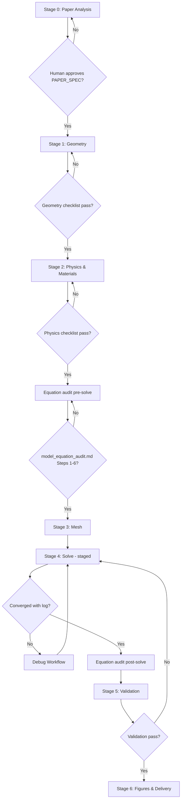

# Simulation Workflow

**Stage-gate process for paper-driven COMSOL multiphysics simulation.**

## Overview



## Stage 0 — Paper Analysis

**Skill:** `paper-analysis`  
**Output:** `PAPER_SPEC.md`  
**Gate:** Human confirms dimensions, BCs, materials

## Stage 1 — Geometry

**Skill:** `geometry-reconstruction`  
**Tools:** COMSOL Java API, SolidWorks STEP  
**Output:** `*_COMSOL_READY.mph`, STEP  
**Checklist:** `checklists/geometry-checklist.md`

Key actions:

- Parametrize all lengths in `model.param()`
- Union fluid → Difference from solid
- Box selections for inlet/outlet/heat

## Stage 2 — Physics & Materials

**Reference:** COMSOL microchannel heat sink tutorial pattern

| Interface | Domain | Key BCs |
|-----------|--------|---------|
| `spf` Laminar Flow | Fluid only | Inlet velocity, outlet p=0 |
| `ht` Heat Transfer | Fluid + solid | Inlet T, heat flux bottom |
| `nitf1` Non-Isothermal | Coupling | Optional; staged later |

Water: ρ, μ, Cp, k — note T-dependence if CHT  
Solid: Si, Al 6063, Cu per paper

**Checklist:** `checklists/physics-checklist.md`

## Stage 2b — Equation Audit (pre-solve)

**Skill:** `simulation-equation-audit`  
**Output:** `model_equation_audit.md` (sections 1–6 minimum)  
**Checklist:** `checklists/model-equation-audit-checklist.md`  
**Template:** `templates/model-equation-audit-template.md`

Gate: research question, coordinates/DOF, parameters/units, governing equations, math↔software mapping, IC/BC documented before mesh/solve.

## Stage 3 — Mesh

- Free tetrahedral or swept in long channels
- Refine at fluid–solid interface and inlet
- Target: resolve channel height with ≥3–5 elements across H (exploratory); more for publication

**Checklist:** `checklists/mesh-checklist.md`

## Stage 4 — Solve (staged)

### 4a Flow-only

```text
Study: std_flow
u_in: ramp 0.05 → target via parametric or manual steps
```

### 4b Thermal

```text
Study: std_heat_stable
Use frozen velocity field OR one-way coupling first
```

### 4c Coupled CHT (optional)

```text
NonIsothermalFlow + continuation
```

**Checklist:** `checklists/convergence-checklist.md`  
**Log:** `templates/simulation-log-template.md`

## Stage 4b — Equation Audit (post-solve)

**Skill:** `simulation-equation-audit`  
Update `model_equation_audit.md` with Steps 7–13: post-processing, scans, numerical stability, A/B/C/D grades.  
Optional: `model_run_log.md`, `model_output_reliability.md`

## Stage 5 — Validation

**Skill:** `validation`  
**Workflow:** `verification-workflow.md`  
Requires completed equation audit; do not assign `PAPER_COMPARABLE` if primary outputs are **C** or **D**.

## Stage 6 — Figures & Delivery

**Skills:** `scientific-figure`, `delivery`  
**Templates:** `result-report-template.md`, `final-delivery-checklist.md`

## COMSOL Batch Command Pattern

```bat
comsolbatch -inputfile model_COMSOL_READY.mph -study std_flow -batchlog solve_flow.log
```

Record `LASTEXITCODE` in simulation log.

## Rules of Engagement for AI

1. Never skip Stage 0 gate
2. Never run Stage 4 without geometry + physics checklists + pre-solve equation audit
3. State validation status on every result message
4. If batch not executed, prefix results with **"PREVIEW / NOT SOLVED"**

## Domain Applications

- MMC manifold microchannels (Lee 2026)
- Bio-inspired channel networks (Tan 2019)
- Fractal microchannels (Sci. Reports 2020)
- SolidWorks STEP + graft from `hangyezhang.m` template
