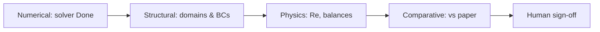

# Verification Workflow

**Physics verification between "solver finished" and "engineering conclusion".**

## Purpose

Separate **numerical convergence** from **physical correctness** and **paper comparability**.

## Verification Layers



## Layer 1 — Numerical Verification

| Check | Pass criterion | Evidence |
|-------|----------------|----------|
| Solver complete | Log "Done" or residual < tolerance | stdout / .status |
| Batch exit | LASTEXITCODE=0 | batch wrapper |
| No fatal errors | No "Failed to find solution" | log excerpt |
| Warnings reviewed | Documented if accepted | README note |

**Fail →** `debugging-workflow.md` (not validation)

## Layer 2 — Structural Verification

| Check | Method |
|-------|--------|
| Fluid-only velocity | Plot `spf.U` — solid hidden |
| Material coverage | Every domain has exactly one material |
| BC on correct boundaries | Visual pick + box selection coords |
| Study solves intended physics | std_flow doesn't activate ht coupling incorrectly |

**Skill:** `validation` + `checklists/physics-checklist.md`

## Layer 3 — Physics Verification

### Required calculations

```text
Re_in, Re_channel (state regime)
ṁ balance
Q ≈ ṁ cp ΔT (CHT)
ΔP inlet to outlet
T_max location and value
```

### Sanity bounds (water, room T inlet)

- T_max < ~373 K at low pressure (unless boiling study)
- |U| max consistent with inlet BC
- Pressure drop positive

### Status assignment

- `FLOW_VALIDATED` — layers 1–2 + mass balance + Re
- `THERMAL_VALIDATED` — + energy sanity + T field
- `NOT_VALIDATED` — any critical check missing

## Layer 4 — Comparative Verification (optional)

Only when paper provides numeric targets:

| Metric | Tolerance policy |
|--------|------------------|
| Topology replication | Qualitative streamlines OK |
| Engineering replicate | ±20–50% ΔP, T trends |
| Publication replicate | Mesh independence + ±10% |

State explicitly which tier this project targets.

## Layer 5 — Human Sign-Off

Agent produces `VALIDATION_REPORT.md` draft.  
Human must check:

```text
[ ] I independently opened mph and inspected fluid selection
[ ] I accept comparison tier: ___________
[ ] Status: ___________
```

Use `prompts/reviewer-mode-prompt.md` for adversarial review.

## Outputs

1. `VALIDATION_REPORT.md`
2. Updated validation status in delivery README
3. If failed: list of blocking items with owner (AI vs human)

## Re-Verification Triggers

Re-run verification when:

- Geometry rebuild
- BC or material change
- Mesh coarsening/refinement > 2× element count change
- Solver strategy change (split → coupled)

## Prohibited Claims

| Claim | Requirement |
|-------|-------------|
| "Validated against paper" | Layer 4 table with numbers |
| "Production ready" | Human sign-off + PAPER_COMPARABLE or waived |
| "Mesh independent" | Two mesh levels documented |
